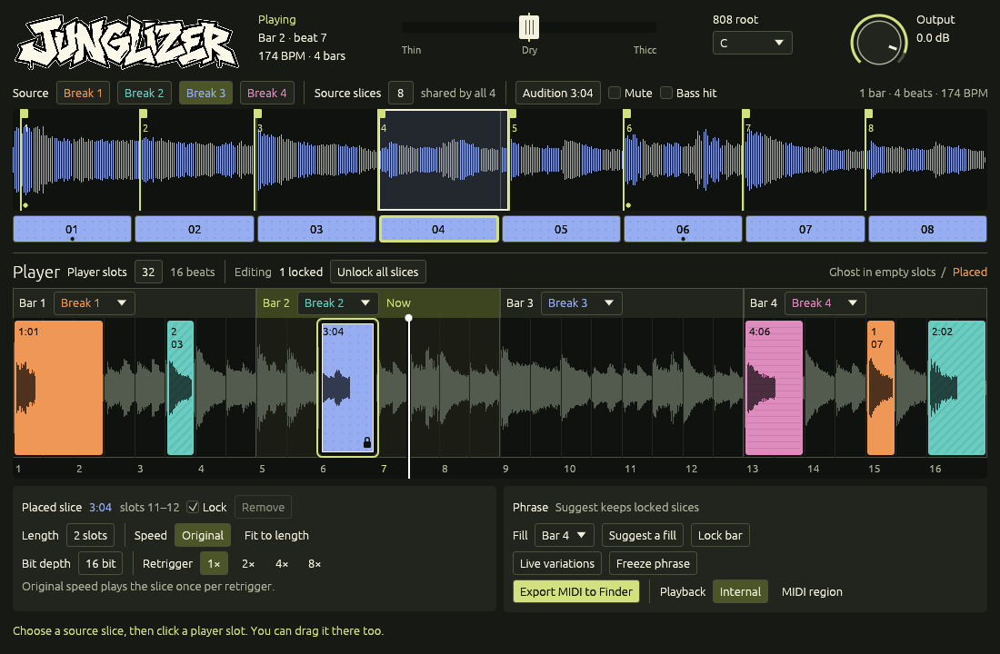

**Junglizer 0.9 beta** is a four-bar break instrument for macOS. It turns four one-bar loops into an editable 16-beat phrase, with AUv2 for Logic Pro and VST3 and CLAP builds for compatible hosts. The supplied 174 BPM stereo breaks are embedded in the plugin, so a downloaded build plays without this source checkout.



## Make a phrase

1. Choose a source break and a shared source slice count (1–32). Each break keeps its own movable, sound-aligned cuts. Click a slice to audition it; right-click to mute it or use the Bass hit checkbox to correct the 808 trigger.
2. Choose a break for each of four bars. The complete break plays as a ghost in empty player slots.
3. Choose 1–32 evenly spaced player slots across the phrase. Drag a source slice onto the player, or select one and click an empty slot. A placement replaces the ghost over its span. Set its length in slots, Original or Fit speed, bit depth, retriggers, and lock.
4. Suggest a fill in one bar, or enable Live variations for a new phrase each four-bar pass. Freeze a phrase to keep it. Freeze and individual placement locks are separate; Unfreeze and Unlock all slices recover editing when needed.
5. Shape the entire player with the Thin / Dry / Thicc crossfader. Thin increasingly high-passes. Thicc reinforces tagged bass hits with a decaying 808 at the chosen root; the far end adds a lower octave. The Output knob adjusts gain.

The player follows host transport and tempo. At tempos other than 174 BPM, the source breaks change speed and pitch to stay on the beat grid. Fit to length also changes pitch; pitch-preserving stretch is planned. Markers, placements, locks, and phrase settings are saved in plugin project state.

## Download and install

Use the [0.9 beta release](https://github.com/mrballistic/junglizer/releases/tag/v0.9.0-beta.1). Pick the archive for your Mac (`arm64` for Apple Silicon, `x86_64` for Intel) and plugin format:

| Format | Copy the unzipped bundle to |
| --- | --- |
| AUv2 / Logic Pro | `~/Library/Audio/Plug-Ins/Components/` |
| VST3 | `~/Library/Audio/Plug-Ins/VST3/` |
| CLAP | `~/Library/Audio/Plug-Ins/CLAP/` |

Restart the host to rescan. These beta archives are ad-hoc signed and are not Apple notarized, so macOS may ask you to allow the plugin in Security settings. The release also provides SHA-256 checksums for every archive. No separate sample installation is needed.

## MIDI export and automation

**Export MIDI to Finder** writes a four-bar `.mid` file to `~/Music/Junglizer/Exports` and reveals it. In Logic, drag the file onto the Junglizer track and choose **MIDI region** playback in the plugin. The file carries slice notes, bar-source choices, and control changes for speed, bit depth, retriggers, length, slot count, tone, and 808 root. The ghost break continues under empty slots. To match an exported phrase, freeze it and leave source markers unchanged; marker edits change how its notes sound. Direct dragging from the plugin into Logic is not yet supported.

The plugin exposes its controls as host automation parameters, including source and player selection, marker position, slice properties, bass tags, tone, output, playback mode, live variations, and momentary actions. Map CS12 controls using Logic's controller assignment workflow. For a momentary action, send a low-to-high transition and return it low before triggering again. Exported MIDI uses channel 1 notes `0..127` for break `0..3` × slice `0..31`; CC `20` is speed, `21` bit depth, `22` retriggers, `23` length, `24` slot count, `25` tone, `26` root, and `30` the bar's ghost break.

## Build and verify

Requires Rust 1.92 or newer, `cargo-truce` 6.3, and Xcode command-line tools on macOS. The four WAV files in `sample/` are embedded at build time.

```sh
cargo fmt --all -- --check
cargo test --locked
cargo truce build --au2 --vst3 --clap
cargo truce validate --auval
```

`cargo truce build` stages the format bundles in `target/bundles/`. `cargo truce install --au2 --user --no-build` installs the staged AU for the current user. The [CI and release workflow](.github/workflows/ci-release.yml) tests pushes and pull requests, then builds both Mac architectures and publishes three format archives per architecture from a version tag. This beta retains the current plugin IDs in `truce.toml`; changing them would affect project recall.

The [UI design brief](docs/UI-DESIGN-BRIEF.md), [implemented design system](DESIGN.md), [validation record](docs/UI-REFRESH-VALIDATION.md), and [0.9 release notes](docs/RELEASE-NOTES-0.9.0-beta.1.md) document the current scope and its limits. Nick Collins's *Algorithmic Composition Methods for Breakbeat Science* ([local PDF](docs/acmethodsforbbsci.pdf)) informed the separation of source cuts, placements, and playback. [Livecut](https://github.com/mdsp/Livecut) inspired the first editable fill suggestion; Junglizer uses its own code and deterministic rendering of accepted fills.
